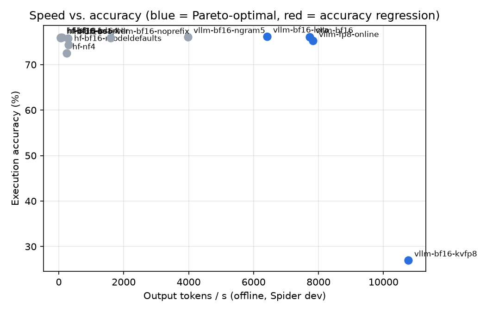

# llm-serving-bench

How fast can a fine-tuned text-to-SQL model be served, and what does each speed-up cost in correctness?

This repo takes my fine-tuned **Qwen2.5-Coder-1.5B** text-to-SQL model ([text-to-sql-finetune](https://github.com/rohilutture/text-to-sql-finetune)) and benchmarks every common serving option against the same execution-accuracy harness on Spider dev:

| Axis | Configurations |
|---|---|
| Engine | HF `transformers.generate` (static batching) vs. **vLLM** (paged KV cache, continuous batching) |
| Precision | bf16 · FP8 (dynamic) · W4A16 GPTQ · W4A16 AWQ · bitsandbytes NF4 (HF) · FP8 KV cache |
| Serving knobs | merged weights vs. live LoRA adapter · prefix caching on/off · n-gram speculative decoding |
| Workload | offline throughput (`bench.runner`) · online latency under concurrency 1–64 (`bench.load_test`) |
| Stretch | **DPO with execution-verified preference pairs** (the database is the reward) |

Every row in the final report is **accuracy and speed together**. A speed-up that costs 3 points of execution accuracy is a decision you make on purpose, not something you find out about later.

## Results

> Fill in from `results/REPORT.md` after running on your GPU. Placeholders below.

| Run | Exec acc | Out tok/s | Speed-up | Δ acc (pts) | Weights GB |
|---|---|---|---|---|---|
| hf-bf16 (baseline) | _TBD_ | _TBD_ | 1.00x | 0 | _TBD_ |
| vllm-bf16 | _TBD_ | _TBD_ | _TBD_ | _TBD_ | _TBD_ |
| vllm-w4a16-gptq | _TBD_ | _TBD_ | _TBD_ | _TBD_ | _TBD_ |
| vllm-fp8 | _TBD_ | _TBD_ | _TBD_ | _TBD_ | _TBD_ |
| vllm-bf16-ngram5 | _TBD_ | _TBD_ | _TBD_ | _TBD_ | _TBD_ |



## Quick start

vLLM needs Linux. On Windows, use **WSL2 (Ubuntu)** with the NVIDIA driver installed on the Windows side. The CUDA toolkit does not need to be installed inside WSL.

```bash
python -m venv .venv && source .venv/bin/activate
pip install -r requirements-gpu.txt

# Spider: download from https://yale-lily.github.io/spider and unzip to data/spider
#   data/spider/{dev.json, train_spider.json, database/<db_id>/<db_id>.sqlite}

# Put the EXACT prompt template used in training into configs/prompt_template.txt
# (placeholders {schema} and {question}). A mismatched template lowers accuracy
# and makes every comparison here meaningless.

BASE=Qwen/Qwen2.5-Coder-1.5B-Instruct \
ADAPTER=../text-to-sql-finetune/checkpoints/best \
LIMIT=200 bash scripts/run_matrix.sh    # quick pass; drop LIMIT for all 1,034
bash scripts/load_matrix.sh             # online latency sweep
```

Then open `results/REPORT.md`.

### Sanity check first
Run `hf-bf16-adapter` on the full dev set before anything else. It should reproduce the **74.2%** from the text-to-SQL repo to within about a point. If it doesn't, the prompt template or the SQL extraction differs from training. Fix that before trusting any other row.

### DPO stretch
```bash
python dpo/make_pairs.py --model models/merged-bf16 --spider-dir data/spider --k 8
python dpo/train_dpo.py  --model models/merged-bf16 --pairs dpo/pairs.jsonl
python scripts/merge_lora.py --base models/merged-bf16 --adapter models/dpo-lora --out models/dpo-merged
python -m bench.runner --backend vllm --model models/dpo-merged --name vllm-dpo --spider-dir data/spider
```

## Tests (CPU, no GPU needed)
```bash
pip install -r requirements-dev.txt && pytest -q
```
The tests cover execution matching (order rules, multisets, invalid SQL, timeouts, read-only DB), SQL extraction, the runner end to end with a mock backend, report/Pareto math, and DPO pair selection.

## Layout
```
bench/
  spider.py         dataset + schema DDL
  prompts.py        template, chat rendering, SQL extraction
  exec_match.py     execution-based correctness with error kinds
  runner.py         offline benchmark -> results/<run>/{summary,predictions,timings}
  load_test.py      online concurrency sweep against `vllm serve` (TTFT, p50/p95/p99)
  report.py         table + speed-vs-accuracy Pareto plot
  backends/         hf.py, vllm_backend.py, mock.py
scripts/            merge_lora.py, quantize.py (llm-compressor), run_matrix.sh, load_matrix.sh
dpo/                make_pairs.py, train_dpo.py (TRL)
```

See **[DESIGN.md](DESIGN.md)** for why each choice was made.
